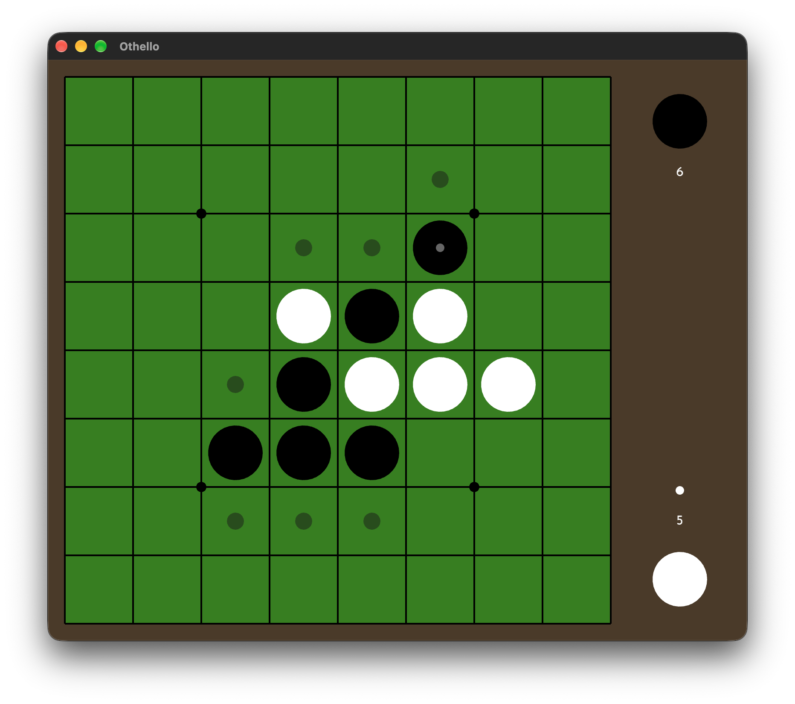
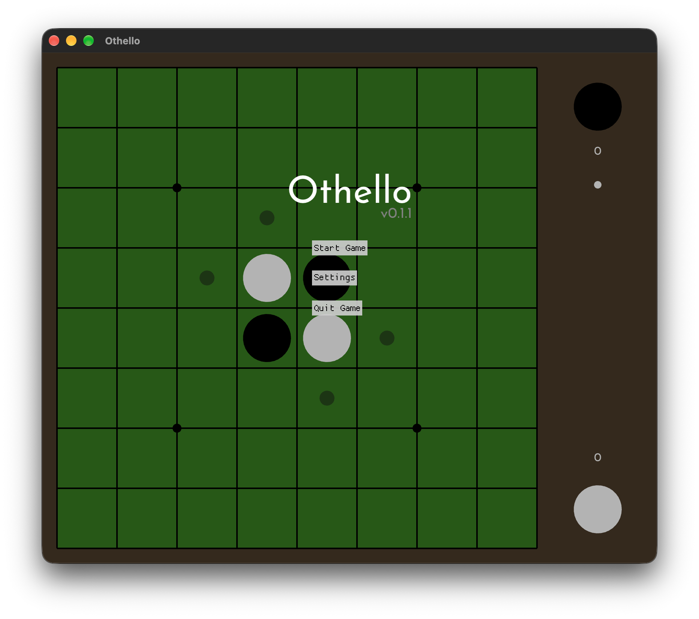
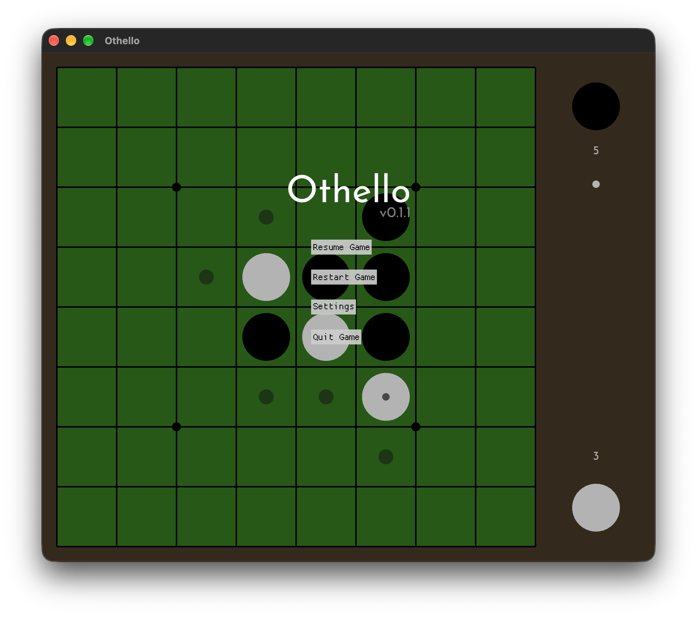
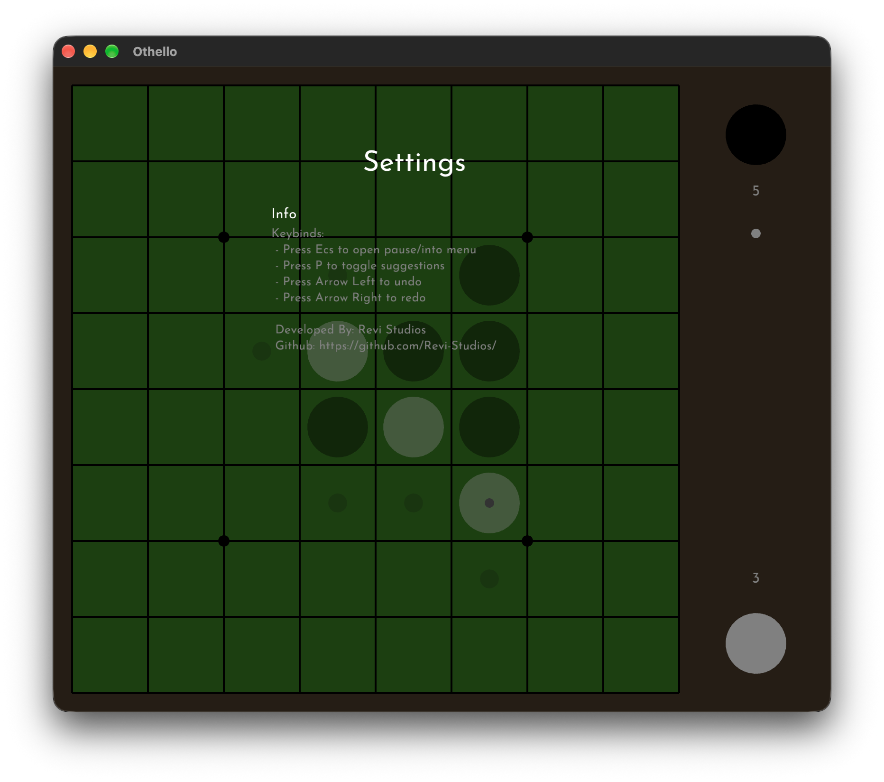
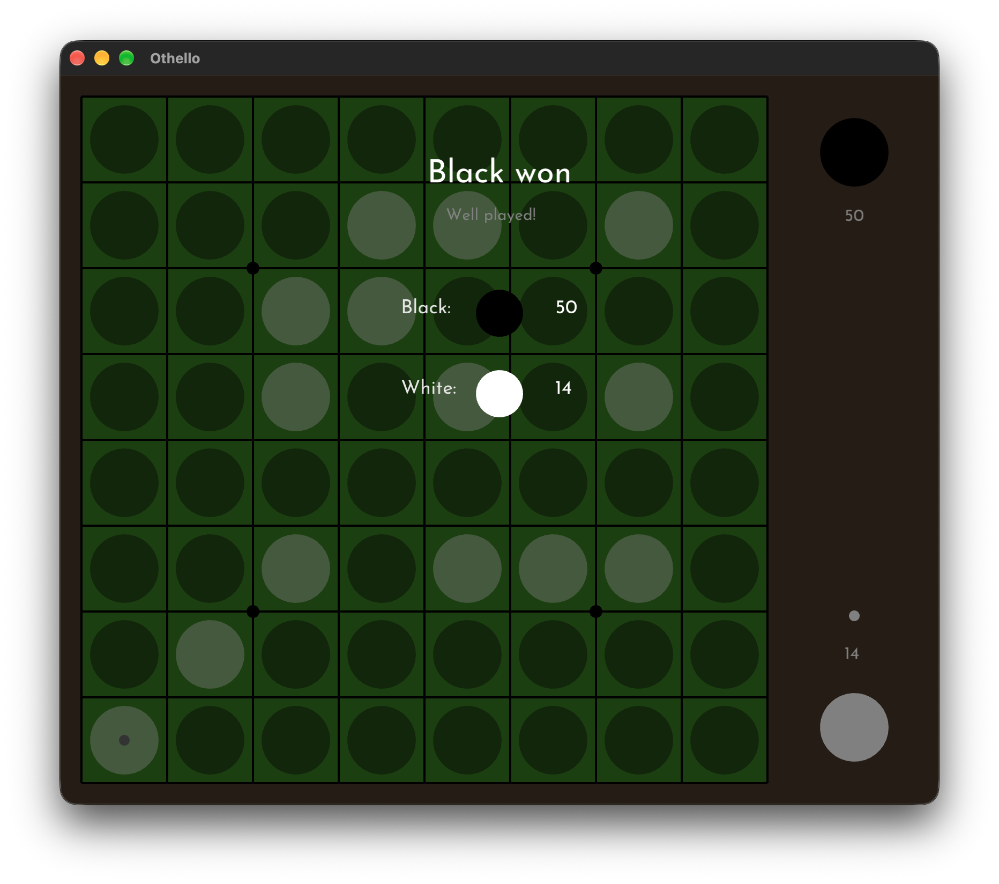

# Othello written in _Rust_

A simple othello game built with [The Rust Programming Language](https://rust-lang.org/) using the [Macroquad](https://macroquad.rs/) immediate mode game engine.

> [!TIP]
> There is a web demo at:
> [https://revi-studios.github.io/othello/](https://revi-studios.github.io/othello/)
>
> There is also a [Roadmap](docs/ROADMAP.md)

|                                                    |                                                        |
| -------------------------------------------------- | ------------------------------------------------------ |
|      |        |
|  |  |
|        |

# Build

Wasm:

1. Build the binary

```
cargo build --release --target wasm32-unknown-unknown && cp ~/.cargo/shared_target/wasm32-unknown-unknown/release/othello.wasm docs/web-demo/
```

2. Host the web page

```
% basic-http-server docs/web-demo
	 INFO basic-http-server 0.11.0
	 INFO addr: http://127.0.0.1:4000
	 INFO root dir: docs/wasm-build
	 INFO extensions: false
	 INFO listening on 127.0.0.1:4000
listening on 127.0.0.1:4000
```
