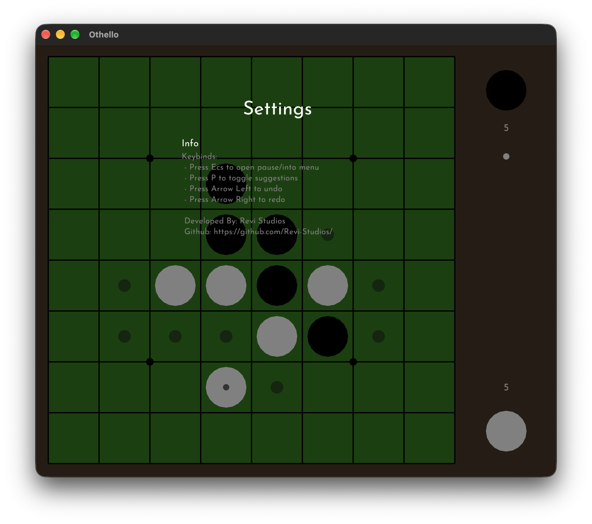

# Othello written in _Rust_

A simple othello game built with [The Rust Programming Language](https://rust-lang.org/) using the [Macroquad](https://macroquad.rs/) immediate mode game engine.

|                                               |                                                   |
| --------------------------------------------- | ------------------------------------------------- |
|     |             |
|  |  |
